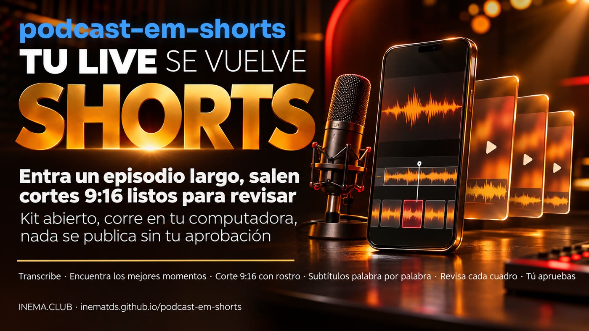

# podcast-em-shorts

[](https://inematds.github.io/podcast-em-shorts/guia/es/)

**🇧🇷 [Português](README.md) · 🇺🇸 [English](README.en.md) · 🇪🇸 [Español](README.es.md)**

## Qué es

podcast-em-shorts es un kit gratuito, hecho en Python, que transforma una grabación larga (podcast, live, entrevista o clase) en videos cortos verticales. Lee la transcripción, identifica los fragmentos que se entienden por sí solos, los recorta en formato 9:16 con el rostro ampliado y la pantalla debajo, escribe los subtítulos palabra por palabra y revisa cada cuadro. Es para quienes graban mucho y no tienen tiempo para editar. Necesitas una computadora con Python y ffmpeg; no necesitas ninguna cuenta, clave ni servicio de pago.

## 📖 Guía de uso

Guía completa (landing + paso a paso): **https://inematds.github.io/podcast-em-shorts/guia/es/**

## Inicio rápido

```bash
git clone https://github.com/inematds/podcast-em-shorts
cd podcast-em-shorts
python3 -m venv .venv
.venv/bin/pip install -r requirements.txt faster-whisper
.venv/bin/python pes.py doutor
.venv/bin/python pes.py novo minha-live --video /caminho/da/live.mp4
.venv/bin/python pes.py tudo minha-live --modelo small --idioma pt
.venv/bin/python pes.py revisao minha-live      # aprueba en la página que se abra
.venv/bin/python pes.py exportar minha-live     # copia solo los aprobados
```

Comandos: `doutor`, `novo`, `transcrever`, `corrigir`, `candidatos`, `escolher`, `gancho`, `layout`, `render`, `checar-quadros`, `checar-conteudo`, `revisao`, `regra`, `exportar`, `tudo`. Cada uno tiene `--help`.

- **El kit no publica nada.** Genera, revisa y organiza; tú apruebas.
- Marca (colores, fuente, subtítulos, duración, cantidad) en `marca/marca.json`.
- Reglas del kit en `regras/REGRAS.md`; las tuyas, a partir de la R200, en `regras/MINHAS-REGRAS.md`.
- Skill para Claude Code / Codex en `skill/podcast-em-shorts/`.
- Ejemplos reales en `exemplos/` (3 shorts de una live de 57 min).
- Pruebas: `python3 -m unittest discover -s tests -v`.

Detalles técnicos: [docs/SPEC.md](docs/SPEC.md) y [docs/IMPLEMENTACAO.md](docs/IMPLEMENTACAO.md).

Fuente Montserrat bajo la SIL Open Font License (`marca/fontes/OFL.txt`). Detector de rostros YuNet (OpenCV Zoo), descargado en la primera ejecución.

---

Hecho por [INEMA.CLUB](https://inema.club) — IA en la práctica, gratis.